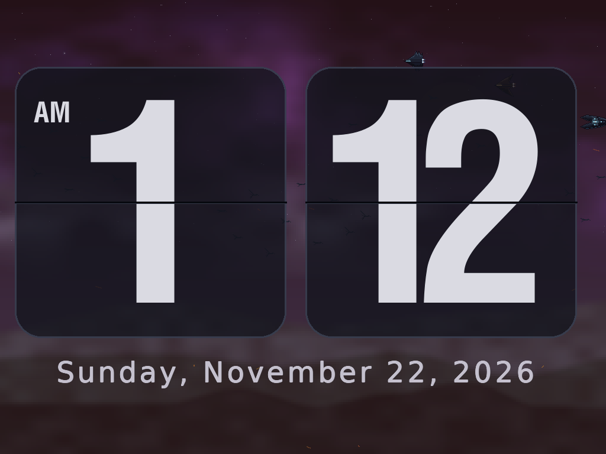

# Gluqlo L-Space

A flip clock that sits inside a night landscape. Things happen behind it while it keeps the time.

L-Space is a fork of [Gluqlo](https://github.com/alexanderk23/gluqlo) by Alexander Kovalenko, an SDL remake of the
[Fliqlo screensaver](http://9031.com/goodies/#fliqlo). Gluqlo is itself based on
[noflipqlo](https://github.com/bhm/noflipqlo) (Now Open Flipqlo 2.0) by [Jacek Kuźniarski](https://github.com/bhm).
The flip cards and the flip animation are theirs. Everything behind and around the cards is new in this branch.
It is not affiliated with, or endorsed by, the upstream project.

## What L-Space adds

A landscape behind the cards that changes with the seasons and the weather, plus a lot of small scenes that
turn up now and then, in the sky and on the hills. See `NOTES.md` if you want the details.

## Requirements

- SDL3
- SDL3_ttf
- Fontconfig
- ttf-dejavu (optional, default for date font is DejaVu Sans Bold)
- XScreensaver (optional, X11)

## Building from source

Install the build-time dependencies (with SDL3, SDL3_ttf, and Fontconfig development packages or built from source):

    $ sudo apt-get install build-essential pkg-config libsdl3-dev libsdl3-ttf-dev libfontconfig-dev

Then compile and install as usual:

    $ make && sudo make install

### Arch Linux

    $ sudo pacman -S --needed base-devel pkgconf sdl3 sdl3_ttf fontconfig
    $ make && sudo make install

### openSUSE (Leap and Tumbleweed)

    $ sudo zypper install gcc-c++ make pkg-config SDL3-devel SDL3_ttf-devel fontconfig-devel
    $ make && sudo make install

`make install` puts the program in `/usr/libexec/xscreensaver`. If your XScreenSaver looks for its programs
somewhere else (for example `/usr/lib64/xscreensaver`), copy `gluqlo` there, or put the full path in
`~/.xscreensaver`, for example `/usr/libexec/xscreensaver/gluqlo -root \n\`.

The Ubuntu PPA from the upstream project installs upstream Gluqlo, not L-Space.

## Usage

To use L-Space as a screensaver you may need to remove gnome-screensaver and install XScreensaver (on Ubuntu see
[this page](http://www.howtogeek.com/114027/how-to-add-screensavers-to-ubuntu-12.04/)). Add it to your
`~/.xscreensaver` config file (in the `programs:` section):

    gluqlo -root \n\

Otherwise, you can just run it as is.

Options: `-root` (fullscreen), `-noflip`, `-ampm`, `-leadingzero`, `-w`, `-h`, `-r WxH`, `-s SCALE`,
`-anykeyclose`, `-effect NAME[:KIND]` and `-seed N`. Run `gluqlo -help` for the list.

### Testing effects

Scenery events normally appear at random times. To see one right away, run only that event on repeat:

    $ gluqlo -effect list          # list effect names and their kinds
    $ gluqlo -effect rare_sky      # repeat one effect
    $ gluqlo -effect rare_sky:67   # force a specific kind
    $ gluqlo -seed 42              # start the scenery at a reproducible point

## Repository layout

- `src/` – the program
- `assets/` – the program's assets
- `NOTES.md` – notes on how the code works
- `dev/` – developer tools; not needed to build

## Credits and licence

- Gluqlo © 2014 Alexander Kovalenko; noflipqlo © 2010–2012 Jacek Kuźniarski.
- L-Space © 2026 tire-regroover, written with the help of AI coding assistants: GitHub Copilot using models from Anthropic Claude, Google Gemini, OpenAI GPT, Hangzhou DeepSeek and Alibaba Qwen. Their output was directed and reviewed by tire-regroover.

Released under the ISC licence, the same as upstream. See `LICENSE`.

## Contributing

1. Fork it!
2. Create your feature branch (`git checkout -b my-new-feature`)
3. Commit your changes (`git commit -am 'Add some feature'`)
4. Push to the branch (`git push origin my-new-feature`)
5. Create new Pull Request!
