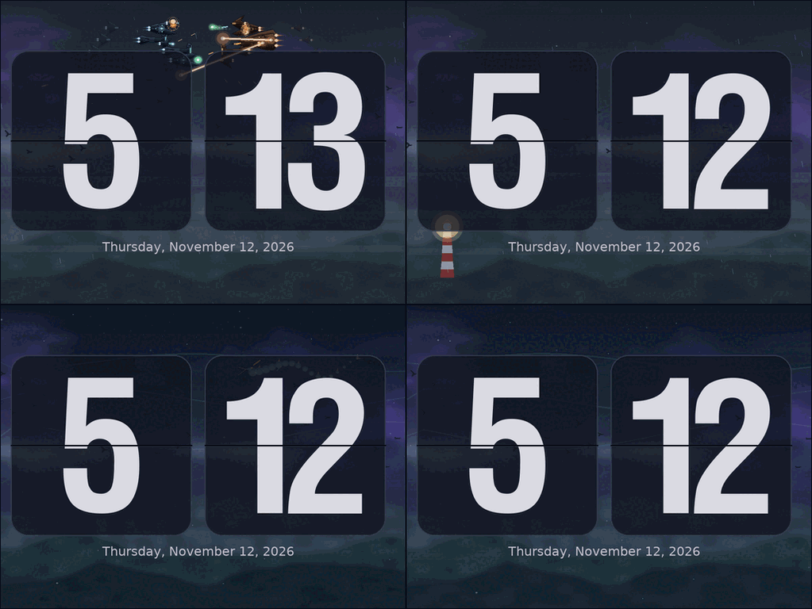

# Gluqlo L-Space

A flip clock that lives inside a night landscape. Seasons turn, the weather changes, ships fight above the
clouds, and over a hundred different things drift through the sky or happen on the hills while the cards
keep the time.

L-Space is a fork of [Gluqlo](https://github.com/alexanderk23/gluqlo) by Alexander Kovalenko, a SDL remake of the
[Fliqlo screensaver](http://9031.com/goodies/#fliqlo). Gluqlo is itself based on
[noflipqlo](https://github.com/bhm/noflipqlo) (Now Open Flipqlo 2.0) by [Jacek Kuźniarski](https://github.com/bhm).
The flip cards and the flip animation are theirs. Everything behind and around the cards is new in this branch.
It is not affiliated with, or endorsed by, the upstream project.

## What L-Space adds

Behind the cards there is a procedurally drawn night landscape: nebula, clouds, stars, three ridges and flocks
of birds. It moves through four seasons and a changing cycle of weather (clear, sunset, rain, storm, snow, fog,
aurora). On top of that, a large set of scenery events turns up at random times. For testing, `-effect NAME[:KIND]`
and `-seed N` show any event on demand.

### Scenery events

Events are drawn behind the cards and fade in and out. They never overlap in a way that would look wrong:
the "takeover" events (alien weather, world jump, long scenes, hill events) take turns, and so do the sky events
(fleet battles, furballs, dogfights, flybys and rare sky events).

- **Rare sky events** – things that cross the sky: comets, dragons, paper planes, soap bubbles, an eclipse, a ghost
  ship, a portal, a pulsar and many more.
- **Hill events** – things that happen on the near ridge: a village, a lighthouse, a train, fireworks, a volcano,
  a space elevator, a castle, a howling wolf and many more.
- **Ship battles** – ship designs, turrets and nine weapons (pulse laser, beam, plasma, mass driver, flak, missile,
  swarm, torpedo and railgun) modelled on the weapon families of *X4: Foundations*.
- **Takeovers** – alien weather (five kinds), world jumps (four destinations), long scenes (garden, flood, fire,
  aurora, a lone watcher), fullscreen events and foreground drifts.

Nothing is stored between frames: every event is a pure function of time, so a frame can be drawn from the time
alone. See `NOTES.md` for how events are scheduled and how to add one.

## Requirements

- SDL 1.2
- SDL_gfx 1.2
- SDL_ttf 2.0
- XScreensaver (optional)

## Building from source

Install the build-time dependencies (Ubuntu/Debian):

    $ sudo apt-get install build-essential libsdl1.2-dev libsdl-ttf2.0-dev libsdl-gfx1.2-dev libx11-dev

Then compile and install as usual:

    $ make && sudo make install

### Arch Linux

    $ sudo pacman -S --needed base-devel sdl12-compat sdl_ttf sdl_gfx libx11
    $ make && sudo make install

The Ubuntu PPA from the upstream project installs upstream Gluqlo, not L-Space.

## Usage

To use L-Space as a screensaver you may need to remove gnome-screensaver and install XScreensaver (on Ubuntu see
[this page](http://www.howtogeek.com/114027/how-to-add-screensavers-to-ubuntu-12.04/)). Add it to your
`~/.xscreensaver` config file (in the `programs:` section):

    gluqlo -root \n\

Otherwise, you can just run it as is.

Options: `-root` (fullscreen), `-noflip`, `-ampm`, `-leadingzero`, `-w`, `-h`, `-r WxH`, `-s SCALE`,
`-anykeyclose`, `-effect NAME[:KIND]` and `-seed N`. Run `gluqlo -help` for the list.

### Testing effects

Scenery events normally appear at random times. To see one right away, run only that event on repeat:

    $ gluqlo -effect list          # list effect names and their kinds
    $ gluqlo -effect rare_sky      # repeat one effect (random kind each time)
    $ gluqlo -effect rare_sky:67   # force a specific kind (here: the ringed planet)
    $ gluqlo -effect hill_event:31 # the lighthouse
    $ gluqlo -seed 42              # start the scenery at a reproducible point

Each launch normally starts at a different point of the season, weather and event schedule.

## Repository layout

- `gluqlo.c` – the whole program
- `NOTES.md` – code review notes, how events are scheduled, how to add an event
- `dev/` – developer tools and design sheets (event check script, ship design sheets); not needed to build

## Credits and licence

- Gluqlo © 2014 Alexander Kovalenko; noflipqlo © 2010–2012 Jacek Kuźniarski.
- L-Space scenery, weather and events © 2026 tire-regroover.
- L-Space was written with the help of AI coding assistants: GitHub Copilot (Anthropic Claude), DeepSeek and Qwen.
  Their output was directed and reviewed by tire-regroover.

Released under the ISC licence, the same as upstream. See `LICENSE`.

## Contributing

1. Fork it!
2. Create your feature branch (`git checkout -b my-new-feature`)
3. Commit your changes (`git commit -am 'Add some feature'`)
4. Push to the branch (`git push origin my-new-feature`)
5. Create new Pull Request!
